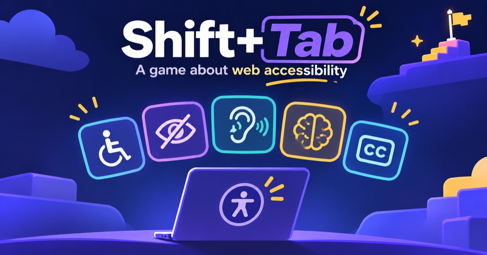

# Shift+Tab



[](https://github.com/izzygld/shift-tab/actions/workflows/deploy.yml)

**Navigate the web the way millions of people do every day. Then fix it.** ▶️ [Play in your browser](https://izzygld.github.io/shift-tab/)


Shift+Tab is a free, open source puzzle game about web accessibility, built for [GitHub Game Off 2026](https://itch.io/jam/game-off-2026) (theme: **SHIFT**).

You're a first-time contributor to **Commons**, the website of a small community nonprofit. People who use a keyboard, a screen reader, zoom, or switch access have filed issues: they can't sign up, donate, or find their way. Each level is one issue:

1. **Reproduce** it with the same assistive technology the reporter uses.
2. **Fix** it by choosing (and later writing) a suggested change.
3. **Verify** it with automated accessibility checks (axe-core) and by replaying it.
4. **Merge**, and hear back from the person who reported it.

> This game does not simulate disability. It teaches how assistive technology works and what developers need to build so it works well.

## Play

- Web: https://izzygld.github.io/shift-tab/ (deployed from `main`)
- itch.io: coming at jam submission

## Run locally

```sh
npm install
npm run dev       # local dev server
npm run validate  # check all levels
npm run build     # production build in dist/
npm test          # accessibility, keyboard and mobile tests (Playwright + axe)
```

## Accessibility of the game itself

A game about accessibility has to pass its own test. Every push runs a [Playwright](https://playwright.dev) + [axe-core](https://github.com/dequelabs/axe-core) suite in CI, and nothing deploys unless it passes:

- **axe scans** of the title screen, every level (before reproducing, alternate modes, fixing, merged) and both ending screens, against WCAG 2.0/2.1/2.2 A and AA plus best practices.
- **A full keyboard-only playthrough** of all levels: real Tab, arrow keys, Enter and Space, with a visible focus indicator checked at every step, focus restored after every re-render, and the level 4 focus trap escaped with Escape.
- **Mobile** (iPhone Safari and Android Chrome emulation): no horizontal scrolling on any screen, and moving between issues returns to the top.
- **Reflow at 320px** (WCAG 1.4.10) and **reduced motion**.

The level pages inside the game are broken on purpose, so they're excluded from the scans. Automated tests can't catch everything, so manual testing with VoiceOver and NVDA is part of the [release checklist](docs/SPEC.md#19-release-checklist). If anything gets in your way, please [report an accessibility barrier](https://github.com/izzygld/shift-tab/issues/new?template=accessibility-barrier.yml).

## Contributing

Levels are plain data (`levels/<id>/level.json` + `page.html`), so you can add one with a pull request. See [CONTRIBUTING.md](CONTRIBUTING.md) and the [language guide](docs/SPEC.md#4-language-and-framing-guide).

## Purpose

- Teaches high-impact WCAG 2.2 success criteria through play.
- Aligned with UN Sustainable Development Goals 4 (Quality Education) and 10 (Reduced Inequalities).
- Planned submission to the Digital Public Goods Alliance registry after the jam.

Full proposal: [docs/SPEC.md](docs/SPEC.md).

## AI disclosure

AI coding assistants (GitHub Copilot) helped write the code, tests, level pages and first drafts of the issue text and feedback. Every level and all copy were reviewed and edited by the author. Paid review of the issue text by disabled testers is planned before the jam deadline. The visual design started from a Figma Make prototype, and the banner and cover art were generated with AI.

## License

- Code: [MIT](LICENSE)
- Levels and written content: [CC BY 4.0](LICENSE-CONTENT)
- Uses [axe-core](https://github.com/dequelabs/axe-core) (MPL-2.0) and [dom-accessibility-api](https://github.com/eps1lon/dom-accessibility-api) (MIT).
